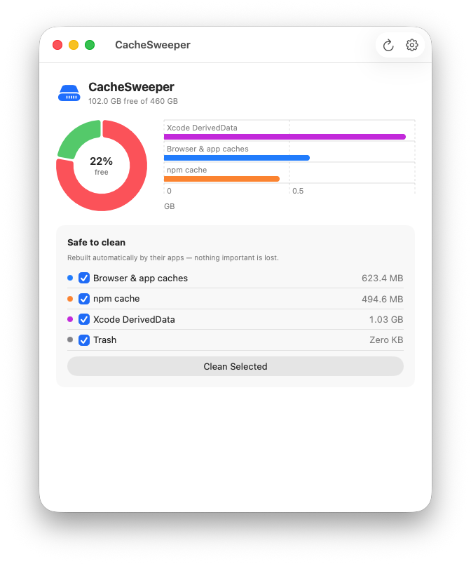

# CacheSweeper Releases

Public release builds for [CacheSweeper](https://github.com/yagnikhk007/cache_sweeper) — a macOS menu bar app for clearing safe cache space (npm, browser/app caches, Xcode DerivedData, Trash) and erasing large unused iOS Simulators.

Source is maintained privately. See the **Releases** tab on this repo for downloads.

## Install

1. Download the `.zip` from the latest release's Assets
2. Unzip it and move `CacheSweeper.app` to `/Applications`
3. Right-click the app → **Open** → **Open** in the dialog (it's ad-hoc signed, not notarized, so Gatekeeper needs this once)
